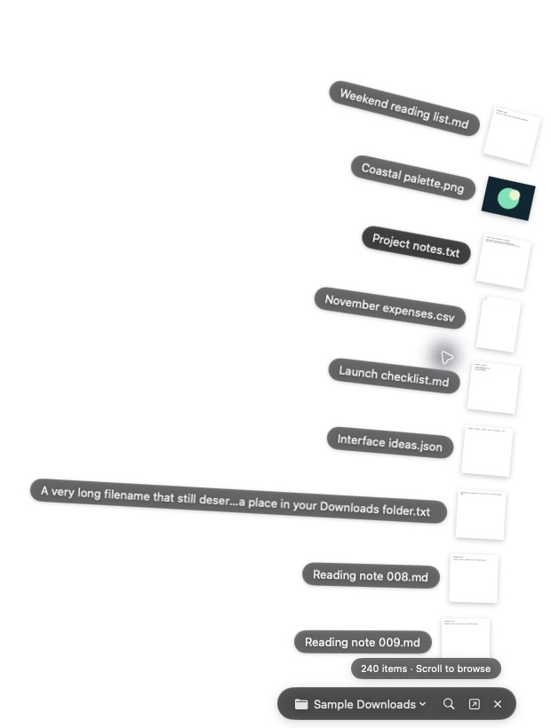

# DownloadScroller

A familiar fan. Room for every file.

DownloadScroller is a native macOS app that opens a **scrollable file fan** from its own Dock icon or the menu bar. Choose Downloads (or another folder), then scroll, search, preview, and open your files without the built-in stack's overflow cutoff.

**Early preview · macOS 14 or later · Swift + SwiftUI + AppKit · MIT licensed**



The fan opens with the newest files at the bottom, closest to the Dock. Scroll up for older files. Compact 44-point file icons and native filename capsules float on a transparent window, with a curve inspired by the macOS Dock fan. Scroll with a trackpad or mouse wheel anywhere in the browsing area, including the gaps between files and the empty space beside them. Search opens at the bottom when you click the magnifying glass or press Command-F; short results stay close to it. The screenshot capture uses a plain backdrop; the running fan floats over your desktop.

DownloadScroller has its own Dock icon and can place launcher documents beside Trash. Each icon toggles its own fan. One launcher can stay at the bottom right of the display while you browse other fans beside it. The menu-bar button also opens the main fan. The app is **not yet published on the Mac App Store**.

## Features

- Continuous scrolling through all visible items, with smooth interpolation for regular mouse wheels and native trackpad momentum.
- A dedicated curved fan that opens at its newest end, with compact system-decorated file icons, rounded filename capsules, and softly fading scroll edges.
- A lone fan shows full filenames and wraps names that reach the screen edge. Fans on the same display shorten labels only when they need to share space. Hover over a shortened name or its icon to read the full name and extension.
- Native macOS materials, semantic colors, and controls that follow light/dark appearance, accent color, and accessibility preferences. Builds made with Xcode 26 or later use Liquid Glass for filename capsules and floating controls on macOS 26 or later; older builds and systems use native vibrancy. Reduce Transparency and Increase Contrast switch to opaque surfaces.
- A running Dock icon that shows the newest completed file with the app's own logo as its badge, regardless of search, filter, or sort order. The logo has light and dark runtime appearances.
- An optional running-app Dock icon, with a menu-bar button available in either mode.
- Multiple launcher files for the Dock's files/folders area. Duplicate a launcher, choose its folder, or enable/disable it independently.
- Search by filename, including multiple words and case-insensitive matches.
- File-type filters and newest, oldest, name, size, or kind sorting.
- Single-click opening, Quick Look, and reveal in Finder.
- Drag a filename or icon into Finder, an app that accepts files, or another open fan. Drop on a folder row to copy into that folder. Press Escape to cancel.
- Live updates when items arrive, disappear, or are renamed.
- Remembered read-only browsing access and a separate permission for each fan that receives copies.
- Keyboard navigation, accessibility labels, and reduced-motion support.
- A sample folder with 240 real generated files to try before granting access.
- Local operation, with no analytics, accounts, network entitlement, or third-party dependencies.

## Build and run

With Apple's Command Line Tools and Swift 6 or later:

```sh
git clone https://github.com/mganesh1610/DownloadScroller.git
cd DownloadScroller
bash scripts/build-app.sh
open dist/DownloadScroller.app
```

The script builds for the current Mac's architecture, creates the app bundle and icon, and applies an **ad-hoc signature with App Sandbox enabled**. This is a local development build, not a notarized download or an App Store distribution package. Build locally or use your own signing identity. Don't disable Gatekeeper to run a downloaded development build.

With full Xcode 16 or later, open `DownloadScroller.xcodeproj`, select your signing team, and run the `DownloadScroller` scheme. Use Xcode 26 or later to include the Liquid Glass controls; they fall back to native materials when running on macOS 14 or 15. The native project also supports universal release builds and archives. Its default bundle identifier is `io.github.mganesh1610.DownloadScroller`; use your own identifier for forks.

On first launch, choose Downloads using the folder picker. The **folder menu** at the bottom of the fan provides sorting, filters, folder selection, disconnect, and pinning. Use the Dock's **Options → Keep in Dock** to keep the app icon there. Closing the fan leaves the app running. **⌘Q** quits it. Both regular and launcher fans close by default when you click outside, including the blank space beside their files. You can work in either open fan before clicking away. Choose **Keep window open** in a fan's folder menu to keep that window visible across apps. Choose **Unpin window** to restore automatic dismissal.

## Dock icon and launcher files

Open **Dock & Launchers…** from the fan's folder menu, the welcome screen's gear, or **⌘,**. Turn **Show app in Dock** on or off; the choice is remembered. The menu-bar button remains available. In either mode, the settings window includes **Privacy Policy** and **Quit DownloadScroller**. A manually pinned app shortcut may remain until you remove it from the Dock yourself.

Choose a name and folder, then **Create launcher → Show in Finder**. Drag the resulting `.downloadscroller` file into the Dock between the divider and Trash. Use **Duplicate** for another launcher and **Change folder…** to choose what it displays. The first launcher you open takes the bottom-right position. To choose a different one, select it in **Dock & Launchers…** and click **Fix on right**. Other fans open beside it on the same display. Clicking the same Dock icon again closes only its fan. The Window menu lets you bring an open fan forward.

**Enabled** controls each launcher's action. A disabled shortcut stays pinned. Each enabled launcher's original file shows its folder's newest completed file with the DownloadScroller badge. The artwork updates while the app runs, even with the fan closed. Empty, unavailable and disabled launchers show the app logo. The last icon stays on the file after quitting. Pin the original from **Show in Finder** and leave it in that location for live updates.

The launcher stores its profile ID and format version in the document and the preview in its custom file icon. Folder permissions stay in this Mac's private app storage. A Finder copy opens the same profile and carries a snapshot of its icon. Use **Duplicate** inside the app for a separate fan with a live icon. In an open launcher fan, **Folder menu → Change this launcher's folder…** assigns a different folder to that launcher.

### Copy between open fans

Drag a filename or icon onto the folder name at the bottom of the other fan to copy into its current folder. Drop directly on a folder row to copy inside it. The receiving fan highlights the destination. You can also right-click a file and choose **Copy to Open Fan**, the recipient, and a folder. Both fans stay open after an accepted transfer.

The first incoming copy asks you to select the receiving fan’s folder and click **Allow copies**. The app remembers this choice for that fan. Originals stay in place. If a name already exists, the new file gets a suffix such as `report copy.pdf` or `report copy 2.pdf`.

## Keyboard shortcuts

| Shortcut | Action |
| --- | --- |
| ↑ / ↓ | Select a file |
| Return | Open selected file |
| Space or ⌘Y | Quick Look (Space while not editing search) |
| ⌘F | Search |
| ⌘R | Refresh |
| ⇧⌘R | Reveal selected file in Finder |
| ⇧⌘O | Choose a folder |
| ⌘1 | Show the panel while the app is active |
| ⌘, | Dock & Launchers settings |
| Esc / ⌘W | Close the panel (Esc clears the query, then hides search, then closes) |
| ⌘Q | Quit |

These shortcuts work while DownloadScroller is active; they are not global hotkeys.

## Development

```sh
swift test                        # Full Xcode: core and app-state XCTest suites
bash scripts/test-app.sh          # All 50 scenarios with Command Line Tools (includes core checks)
bash scripts/prepare-assets.sh    # Regenerate the original vector app icon
python3 scripts/generate-xcode-project.py
```

The 24 core scenarios cover the file library, fan motion, launcher storage, and file copies, including concurrent name collisions and recursive destinations. The 29 app scenarios cover drag initiation and URL export, Escape, repeated Dock clicks, regular Dock icon alignment, saved positions on separate displays, fixed-right placement, filename sizing as neighboring fans open and close, per-fan settings, folder identity, Dock visibility and startup recovery. `scripts/test-core.sh` runs the core checks alone. Native checks also exercise the picker, Launch Services, and Dock integration. CI is configured to run both XCTest suites and build the native target for Apple Silicon and Intel using Xcode 16.4 and 26.3, without distribution signing.

`Sources/DownloadScrollerCore` contains immutable file metadata, classification, queries, and enumeration. `Sources/DownloadScroller` owns the sandbox bookmark, folder watcher, an AppKit fan with native material/text/image views, SwiftUI controls, floating panel, dynamic Dock icon, status item, and Quick Look controller. Fixed row geometry and visible-row reuse keep layout work bounded while scrolling. The icon generator, welcome screen, and Dock badge share the original vector artwork in `AppLogo.swift`. No user-selected file is modified or deleted by the app. Opening a file delegates to the user's chosen application.

For contributor screenshots, quit the app and launch it with `--sample-files --preview-appearance light` (or `dark`, `contrast-light`, `contrast-dark`). Add `--preview-reduce-transparency` or `--preview-increase-contrast` to check each opaque fallback separately, or use `--preview-onboarding` to show the welcome screen. `--preview-controls` adds a temporary **Preview Appearance** menu for switching between Light, Dark, and Follow System while the fan is open. These process-only options leave macOS settings and the saved folder bookmark intact. Quit and relaunch without arguments to resume the normal system appearance and saved folder. See the [light](docs/images/fan-light.png), [dark](docs/images/fan-dark.png), [contrast](docs/images/fan-high-contrast.png), and [reduced-transparency](docs/images/fan-reduced-transparency.png) sample captures and the [logo/badge preview](docs/images/dock-badge.png).

## Current limits

- Each fan shows the immediate visible children of its own folder.
- Directory events trigger a debounced rescan. An enabled launcher's latest file is also watched for edits. For other in-place edits, use **⌘R**.
- Preview availability depends on the Quick Look providers installed on the Mac.
- Cloud-only files may need their provider to download them before opening or previewing.
- The dynamic Dock icon is active while the app runs. With no completed file, the running app shows its logo in the current light/dark appearance. Quitting restores the static bundled icon. The bundle uses traditional icon assets; Icon Composer clear/tinted variants are not included.
- Known partial-download suffixes and folders are excluded from the Dock image; completion of arbitrary file formats cannot be inferred.
- Clicking the regular app icon aligns the bottom file icon with that click on a bottom Dock. The app remembers the position separately for each display, including when you reopen with **⌘1**. Click the app icon again after rearranging the Dock. The designated right-hand launcher keeps its file icons at the right edge and shortens long labels when space is tight. Windows can overlap when the two icons are very close together.
- Dragging offers a copy. External apps control how they use a dropped file. A cloud-only file may need downloading first.
- There is no launch-at-login feature, global shortcut, or automatic updater in this preview.
- Minimum-version testing, Intel runtime testing, and App Store review remain release tasks; compiling for those targets is not equivalent to testing on them.

See [validation notes](docs/VALIDATION.md), [App Store preparation](docs/APP_STORE.md), [privacy](PRIVACY.md), and [contributing](CONTRIBUTING.md).
